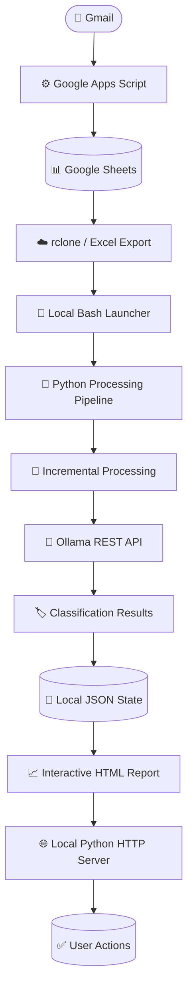

# Job Search AI Tracker

A local-first job application tracking system that collects recruitment emails, classifies them using a locally hosted Large Language Model (LLM), and generates an interactive HTML dashboard to help manage the job search process.

The project combines Google Apps Script, Google Sheets, Python automation, Ollama-based classification, incremental processing, and interactive reporting.

## 🎯 Project Goals

- Centralize recruitment-related emails in a structured dataset.
- Automatically classify job application messages according to their status.
- Identify emails requiring action or follow-up.
- Reduce unnecessary repeated processing through incremental updates.
- Provide an interactive dashboard for reviewing applications and managing follow-up actions.
- Keep LLM inference and report generation on the local machine.
- Demonstrate practical skills in Python automation, LLM integration, data processing, and dashboard development.

## ✨ Features

### Email collection

- Collects Gmail messages associated with a configurable Gmail label.
- Uses Google Apps Script to transfer email records into Google Sheets.
- Adds new messages without importing message IDs already present in the spreadsheet.
- Filters messages using a configurable starting date.
- Creates a daily time-driven trigger to update the spreadsheet automatically.

### AI-assisted classification

The local Python processing pipeline uses Ollama through its REST API to classify recruitment messages.

| Status | Description |
|---|---|
| `Applied` | An application has been submitted, received, or is under consideration. |
| `Action_Required` | The recipient is explicitly asked to complete an assessment, provide documents, answer questions, confirm information, or take another action. |
| `Rejected` | The application has been rejected. |
| `Interview` | An interview, screening, or recruitment call is explicitly requested or scheduled. |
| `Job_Offer` | A job offer has been communicated. |

Classification rules are designed to distinguish explicit interview invitations from generic application updates. For example, a message saying that an application is under review does not automatically qualify as an interview.

The processing pipeline can also identify irrelevant messages collected by the Gmail label.

### Incremental processing and persistence

- Tracks processed messages to reduce unnecessary reclassification.
- Maintains local processing state.
- Supports thread-level deduplication.
- Stores user actions separately from source emails.
- Supports reclassification workflows when rules or model behavior need to be reviewed.

### Interactive dashboard

- Generates an HTML report with interactive visualizations.
- Presents job application information and classification results.
- Supports interactions for managing application-related actions.
- Provides a local Python HTTP server when interactive changes need to be saved.

Generated reports may contain sensitive information and must be treated as private.

## 🧰 Technology Stack

| Technology | Purpose |
|---|---|
| Python 3 | Data processing, classification orchestration, report generation, and local HTTP server. |
| Bash | Workflow automation and execution coordination. |
| Ollama | LLM inference through a locally accessible REST API. |
| Docker | Isolated execution environment for Ollama, where configured. |
| Google Apps Script | Gmail collection, spreadsheet initialization, and scheduled updates. |
| Google Sheets | Intermediate storage for structured email records. |
| rclone | Spreadsheet export and transfer to the local machine, where configured. |
| pandas | Tabular data processing. |
| openpyxl | Excel workbook ingestion. |
| requests | HTTP communication with Ollama. |
| Plotly | Interactive visualizations. |
| HTML, CSS, and JavaScript | Dashboard presentation and client-side interactions. |
| JSON and Excel | Local data exchange and persistence. |
| Ubuntu Linux | Development and execution environment. |

## 🏗️ Architecture



### Processing flow

1. Gmail messages are selected using the configured label.
2. Google Apps Script retrieves the relevant messages and adds new records to Google Sheets.
3. A daily trigger can update the spreadsheet automatically.
4. The local workflow exports or downloads the spreadsheet.
5. Python processes the records and uses the configured Ollama model for classification.
6. Classification results and processing state are stored locally.
7. The HTML dashboard is generated.
8. When the `--serve` option is enabled, the local HTTP server supports dashboard interactions that need to persist user actions.

The Google collection component and the local classification component are separate. Google Apps Script collects and stores email records; it does not classify messages.

## 🔒 Privacy and Data Handling

Privacy is a design consideration, not an assumption that every component runs locally.

- Gmail and Google Sheets are external services used by the collection workflow.
- Google Apps Script operates with the permissions granted to the Google account authorizing it.
- The Python processing engine communicates with the configured Ollama endpoint.
- LLM inference is intended to use the local Ollama service.
- Email content, classification results, and generated reports may contain sensitive personal information.
- Local processing does not eliminate the need to protect credentials, backups, logs, and exported files.

### Files excluded from version control

The following runtime files must not be committed:

```text
data/job_emails.xlsx
data/job_emails.json
data/classified_jobs.json
data/classified_jobs_bkp.json
data/processing_state.json
data/user_actions.json
reportes/reporte.html
```

Backup scripts, Python bytecode, virtual environments, and local configuration files should also be excluded. In particular, `config/local.sh` must be ignored, while `config/local.example.sh` should be committed.

**Privacy principle:** use synthetic or sanitized data for tests, screenshots, demonstrations, and public examples.

If sensitive information is committed accidentally, deleting it from the latest version does not remove it from the repository's history. The affected history and any exposed credentials must be addressed before publishing.

## ⚙️ Setup and Configuration

### 1. Prerequisites

The project is designed for a Linux environment and requires:

- Python 3.
- Bash.
- Git, for version control.
- A Google account with access to the intended Gmail mailbox and Google Drive.
- A configured Google Apps Script project.
- A Google Sheet accessible to the local download workflow.
- A reachable Ollama API endpoint.
- The required Python dependencies.
- rclone, if used by the local spreadsheet export workflow.

Docker is relevant when Ollama is deployed in a container.

### 2. Clone the repository

After the repository has been created:

```bash
git clone https://github.com/Edbeat15/job-search-ai-tracker.git
cd job-search-ai-tracker
```

### 3. Create a Python virtual environment

From the project root:

```bash
python3 -m venv .venv
source .venv/bin/activate
python -m pip install --upgrade pip
python -m pip install -r requirements.txt
```

The `requirements.txt` file should reflect the dependencies imported by the current implementation.

### 4. Configure the Google Apps Script collector

The source code is stored in:

```text
google-apps-script/job_email_collector.gs
```

This file is source code for Google Apps Script. It is not executed directly by the local Python environment.

#### 4.1 Create the Google Apps Script project

1. Open [Google Apps Script](https://script.google.com/) using the Google account that should collect the recruitment emails.
2. Create a new standalone project.
3. Give the project a descriptive name, such as `Job Email Collector`.
4. Open the default script file, usually `Code.gs`.
5. Copy the contents of `google-apps-script/job_email_collector.gs` from the repository into the Apps Script editor.
6. Save the project.

Keep the source file in the repository as the version-controlled reference. Changes made in the Apps Script editor should also be reflected in the repository when appropriate.

#### 4.2 Review the collector configuration

At the top of the script, review the `CONFIG` object.

The current configuration includes:

| Setting | Current value | Purpose |
|---|---|---|
| `LABEL_NAME` | `Job/Analyze` | Gmail label used to select relevant conversations. |
| `FOLDER_NAME` | `Job2026` | Google Drive folder for the spreadsheet. |
| `SPREADSHEET_NAME` | `Job_Emails_2026` | Spreadsheet name. |
| `SHEET_NAME` | `Emails` | Worksheet tab used for email records. |
| `START_DATE` | September 14, 2026 | Earliest message date accepted by the collector. |
| `TIMEZONE` | `America/Mexico_City` | Declared timezone setting in the script. |
| `TRIGGER_FUNCTION` | `updateJobEmailSheet` | Function executed by the daily trigger. |
| `BATCH_SIZE` | `100` | Number of Gmail threads requested per batch. |

The starting date is configurable. Messages dated before it are skipped.

**Important:** the `TIMEZONE` constant is declared in the current script, but the code shown does not use it to set the Apps Script project timezone. Configure the project timezone separately in the Apps Script project settings to ensure that the daily trigger runs according to the intended local time.

#### 4.3 Authorize and initialize the collector

The initial setup requires authorization from Google.

1. In the Apps Script editor, select `setupJobEmailCollector` from the function selector.
2. Click **Run**.
3. Review the permissions requested by Google.
4. Select the intended Google account and complete the authorization flow.
5. If Google displays an additional warning for an unverified script, review the project and proceed only if you trust the source code and understand the permissions being granted.
6. Review the execution log to confirm that setup completed successfully.

The collector requests access to Gmail and Google Drive/Sheets functionality through the services used in the script. Grant only the permissions you are comfortable allowing.

The `setupJobEmailCollector()` function is intended to:

- Create the `Job2026` Drive folder if it cannot find one by name.
- Create or recover the spreadsheet using its stored script property.
- Prepare the `Emails` tab and column headers.
- Perform an initial email collection.
- Create a daily trigger for `updateJobEmailSheet()`.

The spreadsheet ID is stored in the Apps Script project's script properties. Preserve those properties when continuing to use the same collector project.

If the initial execution fails, review the execution log and verify the Gmail label, account permissions, and project configuration before running the setup again.

#### 4.4 Verify the spreadsheet

After successful initialization, open the spreadsheet URL printed in the execution log.

The expected columns are:

```text
Message_ID
Thread_ID
Date
From
To
Subject
Body
Snippet
Gmail_Link
Retrieved_At
```

The collector adds new message IDs to the sheet and skips IDs already present.

The daily trigger is created by the script. Confirm its presence in the Apps Script **Triggers** section and verify that its execution history shows successful updates.

#### 4.5 Changing Google folder or spreadsheet names

If you change any of these settings:

- `FOLDER_NAME`
- `SPREADSHEET_NAME`
- `SHEET_NAME`
- `LABEL_NAME`
- `START_DATE`

review the corresponding dependencies before running the workflow again.

Changing `FOLDER_NAME` may cause the script to use or create a different folder. The current implementation finds folders by name and selects the first match; duplicate folder names in Drive can therefore cause ambiguity.

Changing `SPREADSHEET_NAME` does not necessarily rename or recreate an existing spreadsheet. The collector reuses the spreadsheet ID saved in script properties when that spreadsheet remains accessible.

Changing `SHEET_NAME` requires the local workflow and any other dependent configuration to use the same tab name if they rely on it.

**Changing the Google configuration may also require changes to the local Bash launcher and rclone configuration.** Verify the Drive folder, spreadsheet name or ID, export command, and destination path together. Do not assume that changing a constant in Apps Script automatically updates the local workflow.

### 5. Configure local settings and rclone

Install and configure `rclone` with access to the Google Drive account and spreadsheet used by the collector:

```bash
rclone config
rclone listremotes
```

The current environment has used a specific remote name, but this is installation-specific and must not be assumed on another machine.

The project separates public defaults from local settings:

- `config/local.example.sh` is the safe template committed to Git.
- `config/local.sh` contains the actual local paths and rclone settings and must remain untracked.

Create your local configuration:

```bash
mkdir -p config
cp config/local.example.sh config/local.sh
nano config/local.sh
```

Example `config/local.sh`:

```bash
# Local configuration. Do not commit this file.
BASE_DIR="$HOME/path/to/job-search-ai-tracker"
RCLONE_REMOTE="your_rclone_remote"
RCLONE_FILE_PATH="Job2026/Job_Emails_2026.xlsx"
```

Set `BASE_DIR` to the project/data root expected by your current launcher. It should be the directory whose `script/`, `data/`, and `reportes/` directories are used by the workflow. The launcher and Python script must resolve to the same intended data directory.

`RCLONE_REMOTE` is the name shown by `rclone listremotes`, without a trailing colon. `RCLONE_FILE_PATH` is the spreadsheet path relative to that remote, for example `Job2026/Job_Emails_2026.xlsx`.

Verify access to the configured folder:

```bash
rclone lsf "YOUR_REMOTE:Job2026/"
```

Replace `YOUR_REMOTE` with the remote name from your local configuration. Verify the actual Drive folder and spreadsheet name before running the tracker.

Do not commit `config/local.sh`, rclone configuration files, tokens, or credentials to the repository.

### 6. Configure Ollama

Ensure the Ollama service is running and that the Python process can reach its API.

The commonly used local endpoint is:

```text
http://localhost:11434
```

Test connectivity:

```bash
curl -fsS http://localhost:11434/api/tags
```

The model configured in the local processing pipeline must be available through that endpoint. The current environment has used `granite-job:latest`, while other Granite models may also be installed. Confirm the actual model name in the local configuration.

If Ollama runs in Docker, verify that the container is running and that the API is reachable from the host process. Container networking may require additional configuration.

### 7. Run the tracker

From the project root, make the launcher executable if necessary, activate the virtual environment, and execute it. The launcher loads `config/local.sh`; it exits with an error if that local configuration is missing.

```bash
chmod +x script/actualizar_job_tracker.sh
source .venv/bin/activate
./script/actualizar_job_tracker.sh --serve
```

The local configuration file is not created automatically. Copy `config/local.example.sh` to `config/local.sh` and edit the values before the first run.

The `--serve` option enables the local report server as part of the workflow.

Open the local address printed by the script. The current implementation uses port `8765` by default:

```text
http://127.0.0.1:8765/
```

Keep the terminal open while using the interactive interface.

The server binds to `127.0.0.1` in the current implementation, which is intended for local access rather than direct exposure to the public internet.

If execution fails, review the output and verify the spreadsheet export configuration, Python dependencies, Ollama connectivity, and model availability.

## 📁 Project Structure

```text
job-search-ai-tracker/
├── README.md
├── .gitignore
├── requirements.txt
├── config/
│   ├── local.example.sh
│   └── local.sh                 # Local only; excluded from Git
├── google-apps-script/
│   └── job_email_collector.gs
├── model/
│   └── Modelfile_job
├── script/
│   ├── actualizar_job_tracker.sh
│   ├── procesar_job_emails.py
│   └── bkp/                  # Local backups; excluded from Git
├── data/
│   └── .gitkeep
├── reportes/
│   └── .gitkeep
├── tests/                    # Planned, if not implemented
└── docs/                     # Planned, if not implemented
```

Some local files and directories are created at runtime and intentionally excluded from version control.

| Path | Responsibility |
|---|---|
| `google-apps-script/job_email_collector.gs` | Collects Gmail messages into Google Sheets and configures scheduled updates. |
| `script/actualizar_job_tracker.sh` | Coordinates spreadsheet export and local processing. |
| `script/procesar_job_emails.py` | Processes email data, coordinates classification, manages local state, generates the report, and provides the local server. |
| `model/Modelfile_job` | Defines the local Ollama model configuration when used by the setup workflow. |
| `data/` | Stores source exports, classification results, processing state, and user actions. Private runtime files are excluded from Git. |
| `reportes/` | Stores generated HTML reports, excluded from Git. |
| `requirements.txt` | Lists Python dependencies. |
| `config/local.example.sh` | Public template for machine-specific settings. |
| `config/local.sh` | Private local paths and rclone settings; must be excluded from Git. |
| `.gitignore` | Excludes private data, generated files, backups, and local development artifacts. |
| `tests/` | Intended for automated tests using synthetic data, once implemented. |
| `docs/` | Intended for architecture and configuration documentation, once implemented. |

## 🧪 Testing and Quality

The project is under active development. Testing is being expanded alongside new features.

Recommended checks include:

- Python syntax validation.
- Bash syntax validation.
- Dependency consistency.
- Classification rules tested with synthetic recruitment messages.
- Incremental processing and thread deduplication.
- Persistence of completed and dismissed actions.
- Handling of new messages in existing threads.
- HTML and JavaScript syntax validation.
- Verification that dashboard interactions update the expected state.
- Verification that sensitive runtime data is excluded from version control.
- Verification of the Google Apps Script setup, authorization, and scheduled trigger.

### Local syntax checks

From the project root:

```bash
python3 -m py_compile script/procesar_job_emails.py
bash -n script/actualizar_job_tracker.sh
```

If the virtual environment is active:

```bash
python -m pip check
```

Automated tests should not require access to a personal Gmail account or real recruitment emails.

## 🗺️ Development Roadmap

The following roadmap describes project capabilities and possible future work. Verify each item against the current code before treating it as complete.

- [x] Gmail label-based collection workflow.
- [x] Google Sheets integration.
- [x] Local data ingestion and structured processing.
- [x] Local Ollama-based classification.
- [x] Incremental processing of recruitment messages.
- [x] Interactive HTML report generation.
- [x] Local HTTP server for interactive report actions.
- [ ] Expand automated tests using synthetic recruitment messages.
- [ ] Improve installation and troubleshooting documentation.
- [ ] Review classification quality and edge cases systematically.
- [ ] Add sanitized sample data and screenshots for public demonstrations.
- [ ] Establish a release and versioning strategy.

## 🤝 Contributing

**Contributions and collaboration requests are welcome!**

This project is currently maintained with controlled access while its documentation, configuration, and workflows are being reviewed. If you are interested in contributing, please contact the repository owner before requesting write access.

### How to request collaboration

Please contact me through my GitHub profile:

**GitHub:** [@Edbeat15](https://github.com/Edbeat15)

Include the following information in your request:

- **GitHub username:** Your GitHub account.
- **Introduction:** A brief description of your background and relevant experience.
- **Area of interest:** The component or area you would like to work on, such as Python, Bash, Google Apps Script, Ollama/LLM classification, reporting, testing, or documentation.
- **Proposed contribution:** The problem you want to solve, the improvement you suggest, or the issue you would like to investigate.
- **Relevant experience:** Links to previous projects, contributions, or examples of your work, if available.

Please explain what you intend to change and why it would benefit the project. You do not need to have contributed to an open-source project before to request collaboration.

### Collaboration process

1. Submit a collaboration request with the information above.
2. Wait for the project owner to review your proposal.
3. If approved, receive the minimum repository permissions required for the agreed contribution.
4. Coordinate the scope of the work and review process before making changes.

Access is granted on a case-by-case basis. A collaboration request does not guarantee repository access.

### Security and project guidelines

- Never commit credentials, API keys, access tokens, personal information, or private job-search data.
- Keep local configuration files, datasets, generated reports, and other private information out of version control.
- Do not introduce new dependencies, external services, or automated workflows without discussing them first.
- Explain the purpose and impact of proposed changes, particularly changes involving data handling, external requests, or LLM processing.
- Test changes before submitting them and document any new configuration requirements.
- Respect the project's local-first and privacy-oriented design goals.

The project owner reserves the right to approve, decline, limit, or revoke repository access to protect the project and its data.

## 📄 License

No license has been specified yet. Unless a license is added to the repository, reuse and redistribution are not automatically granted.

## ⚠️ Disclaimer

This project is a personal productivity and portfolio project. AI-generated classifications may be incorrect and should be reviewed before taking action on a job application.

The project is not affiliated with Google, Gmail, Google Sheets, Ollama, or any employer or recruitment platform.
